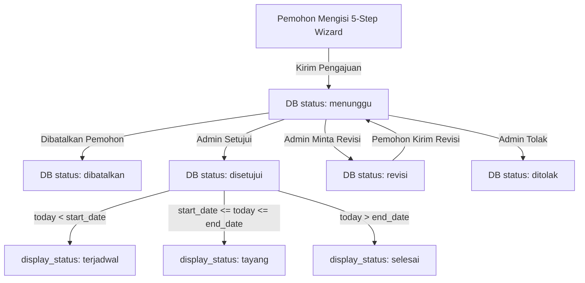

# 🖥️ E-VITRON — Sistem Layanan & Kurasi Penayangan Videotron UIN Siber Syekh Nurjati Cirebon

**E-VITRON** (*Electronic Videotron System*) adalah aplikasi web berbasis **Laravel 13 & Filament v3 (PHP 8.3)** untuk digitalisasi layanan permohonan, kurasi konten, penjadwalan, dan pelaporan arsip penayangan pada perangkat layar videotron kampus **UIN Siber Syekh Nurjati Cirebon (UINSSC)** yang dikelola bersama **PUSTIKOM UINSSC**.

> **Catatan Penamaan Internal (*Legacy Identifier*):**  
> Pada tahap awal pengembangan aplikasi ini bernama **SIPETRON** sebelum resmi berganti merek menjadi **E-VITRON**. Beberapa pengenal internal seperti [`config/sipetron.php`](config/sipetron.php), *cache key* `sipetron_settings_cache`, CSS [`public/css/sipetron-custom.css`](public/css/sipetron-custom.css), serta perintah Artisan `sipetron:*` sengaja dipertahankan untuk menjaga kompatibilitas kode dan pengujian.

---

## 🛠️ Stack Teknologi & Prasyarat

* **Backend:** PHP `^8.3` (`ext-zip`, `ext-gd` / `ext-mbstring`, `pdo_mysql`), Laravel Framework `^13.17`
* **Panel Admin:** Filament PHP `^3.2` (Livewire + Server-Driven UI)
* **Frontend Portal:** Blade, Tailwind CSS `^4.0`, aset lokal `public/js/tailwind.js` & `public/js/alpine.min.js`, Vite `^8.0`
* **Ekspor Dokumen:** `barryvdh/laravel-dompdf` `^3.1` (PDF resmi) & PHP `ZipArchive` (Excel `.xlsx` tanpa pustaka eksternal tambahan)
* **Basis Data:** MySQL / MariaDB (pengembangan & produksi), SQLite `:memory:` (khusus PHPUnit)
* **Pengujian & Gaya Kode:** PHPUnit `^12.5.12` & Laravel Pint `^1.27`

---

## 🚀 Panduan Instalasi & Setup Lokal

> **Penting tentang `.env.example`:** File `.env.example` bawaan masih disetel ke `DB_CONNECTION=sqlite` dan `BRIDGE_SSO_SIMULATE=false`. Untuk menjalankan aplikasi secara penuh di lingkungan lokal (misalnya Laragon), sesuaikan variabel database ke **MySQL** dan aktifkan simulasi SSO jika belum terhubung ke jaringan API kampus.

```bash
# 1. Masuk ke direktori proyek & instal dependensi
cd videotron-uin-ssc
composer install
npm install

# 2. Siapkan environment
cp .env.example .env
php artisan key:generate
```

Sesuaikan bagian berikut pada `.env` lokal Anda:

```dotenv
APP_NAME="E-VITRON"
APP_ENV=local
APP_TIMEZONE=Asia/Jakarta
APP_LOCALE=id
APP_FALLBACK_LOCALE=id

# Database MySQL (pastikan database sudah dibuat terlebih dahulu)
DB_CONNECTION=mysql
DB_HOST=127.0.0.1
DB_PORT=3306
DB_DATABASE=videotron_uin_ssc
DB_USERNAME=root
DB_PASSWORD=

SESSION_DRIVER=file
CACHE_STORE=file

# Integrasi SSO Portal Akademik (set true untuk simulasi lokal tanpa VPN/server kampus)
BRIDGE_SSO_ENABLED=true
BRIDGE_SSO_BASE_URL=https://bridge.uinssc.ac.id
BRIDGE_SSO_TIMEOUT=8
BRIDGE_SSO_SIMULATE=true
```

Lanjutkan proses inisialisasi basis data dan aset:

```bash
# 3. Jalankan migrasi & isi data awal (wajib SettingSeeder + DatabaseSeeder)
php artisan migrate --seed
php artisan db:seed --class=SettingSeeder

# 4. Tautkan storage publik & bangun aset Vite
php artisan storage:link
npm run build

# 5. Jalankan server pengembangan lokal
php artisan serve
```

---

## 🔑 Akun Demo Bawaan (`DatabaseSeeder`)

| Peran | Jalur Masuk | Username (`NIM / NIP / Email`) | Password | Catatan |
| :--- | :--- | :--- | :--- | :--- |
| **Admin Pengelola** | `/login` atau `/admin` | `admin@uin.ac.id` | `admin123` | Akses penuh Panel Filament `/admin` |
| **Mahasiswa (Pengaju 1)** | `/login` | `2208101001` | `password` | Pemilik 5 tiket pengajuan contoh |
| **Mahasiswa (Pengaju 2)** | `/login` | `2388010999` | `password` | Pengaju FITK (`campus_sso`) |
| **Dosen (Pengaju)** | `/login` | `198501012015011002` | `password` | Pengaju dosen (`campus_sso`) |

*(Catatan: Pendaftaran mandiri di `/register` ditujukan bagi **Tendik / Mitra Eksternal**. Akun pendaftar baru otomatis berstatus `pending` dan tidak dapat masuk sebelum disetujui Administrator di menu **Persetujuan Akun**).*

---

## 🧠 Konsep Penting Kode *(Wajib Dibaca Developer Penerus)*

Bagian ini merangkum aturan arsitektur yang paling sering menjadi sumber kebingungan jika langsung membaca kode tanpa konteks:

### 1. Status Tersimpan (`status`) vs Status Tampilan (`display_status`)
Di tabel `submissions`, kolom `status` **hanya** menyimpan status keputusan inti:
* `menunggu`, `revisi`, `disetujui`, `ditolak`, `dibatalkan` *(serta menghormati `'selesai'` bila tersimpan eksplisit)*.

Status **`terjadwal`**, **`tayang`** (*Sedang Tayang*), dan **`selesai`** **bukan nilai kolom database**, melainkan dihitung dinamis oleh *accessor* `$submission->display_status` (`App\Models\Submission::getDisplayStatusAttribute`) berdasarkan `start_date` dan `end_date` (zona waktu `Asia/Jakarta`):
* `today < start_date` $\rightarrow$ `'terjadwal'`
* `start_date <= today <= end_date` $\rightarrow$ `'tayang'`
* `today > end_date` $\rightarrow$ `'selesai'`

> ⚠️ **Jangan** menulis query `Submission::where('status', 'tayang')`. Untuk memfilter tiket aktif tayang atau selesai secara database, query `status = 'disetujui'` lalu bandingkan `start_date` / `end_date`.

### 2. Alur Siklus Hidup Pengajuan (*Submission Lifecycle*)



### 3. Aturan Kata Kunci Wajib saat Permintaan Revisi
Pada `App\Services\SubmissionDecisionService::requestRevision()`:
* Jika admin meminta revisi tanpa parameter `revisionType` eksplisit, sistem memeriksa isi catatan (`$feedback`, minimal 5 karakter).
* Catatan **wajib** memuat kata kunci dokumen/surat (`surat`, `pdf`, `dokumen`, `stempel`, `ttd`, `berkas`, dll.) dan/atau kata kunci materi (`drive`, `link`, `video`, `poster`, `resolusi`, `durasi`, `materi`, dll.).
* Jika keduanya tidak ditemukan, service akan melempar `DomainException`. Nilai terdeteksi (`surat`, `materi`, atau `keduanya`) dibaca oleh `$submission->effective_revision_type` untuk menentukan *field* mana saja yang muncul pada form revisi di [`SubmitRevisionRequest.php`](app/Http/Requests/SubmitRevisionRequest.php).

### 4. Rotasi Tayang & Sinkronisasi Kondisi Perangkat
* **Rotasi Playlist Bersamaan:** `SubmissionDecisionService::checkAvailabilityAndConflicts()` **mengizinkan** beberapa pengajuan disetujui pada layar dan rentang tanggal yang sama (karena videotron memutar materi secara *looping playlist* bergilir), namun **menolak persetujuan** bila perangkat sasaran sedang `is_active = false` atau berkondisi `gangguan` / `dalam_perbaikan` / `rusak`.
* **Hook Model `Videotron::booted()`:** Saat `condition` diubah ke `gangguan` atau `dalam_perbaikan`, model otomatis menyetel `is_active = false`. Saat `condition` dipulihkan ke `normal`, model otomatis mengaktifkan kembali layar dan membersihkan `issue_notes` serta `estimated_recovery_date`.

### 5. Autentikasi Terpadu (`BridgeSSOService`) & Mitigasi OWASP
* **Alur Login (`/login`):** Kredensial NIM/NIP diteruskan ke `BridgeSSOService` (`POST /api/v2/portal/login`). Jika berhasil, data user dibuat/diperbarui otomatis (`auth_type = campus_sso`). Jika server SSO mati/gagal koneksi, sistem melakukan *fallback* ke akun lokal bila tersedia.
* **Proteksi Admin (OWASP A07):** Akun dengan `role === 'admin'` **diblokir agar tidak dapat ditimpa** melalui jalur login SSO meski identifier numeriknya cocok, dan admin wajib masuk menggunakan akun lokal.
* **Rate Limiter:** `AppServiceProvider` membatasi rute `/login` maksimal **5 percobaan gagal per menit** per `identifier|IP` (`HTTP 429`).

### 6. Eloquent Strict Mode & *Runtime Cache*
* `AppServiceProvider` mengaktifkan `Model::shouldBeStrict(! $this->app->isProduction())` sehingga N+1 *lazy loading* maupun akses atribut yang belum di-*select* langsung memicu exception di lingkungan pengembangan/pengujian. Selalu gunakan *eager loading* (`->with(...)`).
* `Setting::allCached()`, `Submission::$runtimeStatusCounts`, dan `Videotron::getOperationalStats()` menyimpan hasil sementara di memori per siklus HTTP *request* untuk mencegah *query* SQL berulang, dan otomatis dibersihkan saat model disimpan/dihapus.

---

## 🗄️ Skema Basis Data (7 Entitas Utama)

| Tabel | Fungsi Utama |
| :--- | :--- |
| `users` | Data pengguna (`admin`, `mahasiswa`, `dosen`, `tendik`, `mitra`), `identifier`, `auth_type` (`local`/`campus_sso`), `account_status` (`pending`/`approved`/`rejected`). |
| `videotrons` | Data master 6 titik videotron kampus (`name`, `location`, `resolution`, `orientation`, `operating_hours`, `condition`, `is_active`). |
| `submissions` | Data inti pengajuan (`ticket_code`, `content_type`, `gdrive_link`, `surat_peminjaman`, `video_duration_seconds`, `start_date`, `end_date`, `status`, `material_downloaded_at`). |
| `submission_videotron` | Tabel *pivot* relasi *many-to-many* antara `submissions` dan `videotrons` beserta `playback_status`. |
| `submission_revisions` | Riwayat permintaan revisi admin dan balasan perbaikan (`revision_type`, `admin_feedback`, `previous_*`, `new_*`, `user_reply`). |
| `submission_status_histories` | Log audit transisi status pengajuan (`from_status`, `to_status`, `notes`, `user_id` admin/pelaku). |
| `settings` | Konfigurasi dinamis key-value (grup `signatory`, `policy`, `service`, `helpdesk`) diakses via helper global `setting($key, $default)`. |

---

## 📂 Peta Struktur Kode Proyek

```text
├── app/
│   ├── Console/Commands/
│   │   └── CleanUserDemoData.php              # Command sipetron:clean-user-demo-data
│   ├── Filament/
│   │   ├── Pages/                             # Dashboard, HistoryAndRecap, ManageSettings (4 Tab)
│   │   ├── Resources/                         # SubmissionResource, UserResource, VideotronResource
│   │   └── Widgets/                           # SubmissionTrendChartWidget, UpcomingBroadcastsWidget, VideotronUsageChartWidget
│   ├── Http/
│   │   ├── Controllers/                       # AuthController, HomeController, SubmissionController, NotificationController, RecapPrintController
│   │   ├── Middleware/                        # EnsureAdminRole, EnsureApplicantRole, FilamentAuthenticate, PreventBackHistory
│   │   ├── Requests/                          # StoreSubmissionRequest, SubmitRevisionRequest
│   │   └── Responses/                         # FilamentLogoutResponse
│   ├── Models/                                # User, Videotron, Submission, SubmissionRevision, SubmissionStatusHistory, Setting
│   ├── Notifications/                         # AccountApprovalNotification, AdminAlertNotification, SubmissionStatusNotification, VideotronConditionNotification
│   ├── Observers/                             # SubmissionObserver (auto-notify ke admin saat pengajuan baru)
│   ├── Policies/                              # SubmissionPolicy (otorisasi view, downloadSurat, cancel, submitRevision)
│   ├── Providers/                             # AppServiceProvider & Filament\AdminPanelProvider
│   ├── Services/
│   │   ├── ArchiveReportExportService.php     # Pembuat PDF Rekap (DomPDF) & Excel .xlsx native (ZipArchive)
│   │   ├── BridgeSSOService.php               # Integrasi & mode simulasi API Bridge SSO UINSSC
│   │   └── SubmissionDecisionService.php      # Logika Approve, RequestRevision, Reject, & MarkMaterialDownloaded
│   └── Support/helpers.php                    # Fungsi global setting()
├── config/
│   ├── services.php                           # Konfigurasi bridge_sso
│   └── sipetron.php                           # Default penandatangan cetak laporan
├── database/
│   ├── migrations/                            # 18 berkas migrasi skema & indeks performa jangka panjang
│   └── seeders/                               # DatabaseSeeder, SettingSeeder, VideotronSeeder, AdminNotificationSeeder, DemoTrendSeeder, FixNotificationFormatSeeder, RemoveDuplicateNotificationsSeeder
├── public/
│   ├── css/sipetron-custom.css                # Styling kustom Panel Admin Filament
│   ├── downloads/                             # Template surat resmi: Template-Surat-Permohonan-Videotron-UINSSC.docx
│   ├── images/                                # Logo UINSSC, icon, & foto kampus aktif
│   └── js/                                    # tailwind.js & alpine.min.js lokal (tanpa ketergantungan CDN saat offline)
├── resources/views/
│   ├── admin/                                 # Template cetak & PDF admin (recap-pdf, recap-print, submission-single-pdf, partials/kop-surat)
│   ├── auth/                                  # Login, Register & partials/footer-and-help-modal
│   ├── emails/                                # Template email account-approval & submission-status
│   ├── errors/                                # Halaman galat kustom 403, 404, 419, 429, 500, 503
│   ├── filament/                              # View & partials kustom Pages, Resources, Widgets, Modals
│   ├── layouts/                               # Portal layout & partials (Navbar, Notif Drawer, Toast, Scripts)
│   ├── notifikasi/                            # Halaman manajemen notifikasi pemohon
│   └── pengajuan/                             # Wizard (step 1–5), Index, Show, Detail Drawer, & bukti-pengajuan-pdf
├── routes/
│   ├── console.php                            # Command sipetron:prune-storage & jadwal harian 03:00 WIB
│   └── web.php                                # Rute Auth, Beranda/Panduan, Pengajuan, Notifikasi, & Admin Export/Print
├── storage/app/private/surat_peminjaman/      # Penyimpanan privat PDF surat permohonan (non-public)
└── tests/                                     # 1 Unit test + 14 Feature test suites (123 kasus uji)
```

---

## 🔗 Peta Rute & Keluaran Dokumen Utama

* **Portal Pemohon (`EnsureApplicantRole` + `PreventBackHistory`):**
  * `/` (`home`), `/informasi` (`panduan`), `/login`, `/register`, `/logout`
  * `/pengajuan` (`index`), `/pengajuan/baru` (`create`), `POST /pengajuan/simpan` (`store`), `/pengajuan/{ticket_code}` (`show`), `/pengajuan/{ticket_code}/cetak` (`printProof` $\rightarrow$ [`bukti-pengajuan-pdf.blade.php`](resources/views/pengajuan/bukti-pengajuan-pdf.blade.php)), `POST /pengajuan/{ticket_code}/batal`, `POST /pengajuan/{ticket_code}/revisi`
  * `/pengajuan/{ticket_code}/surat` (`downloadSurat` — dilindungi `SubmissionPolicy::downloadSurat`, hanya pemilik tiket atau admin)
  * `/notifikasi/*` (JSON polling `cek-terbaru`, tandai baca, hapus semua)
* **Panel Admin Filament (`/admin`, `FilamentAuthenticate` + `EnsureAdminRole`):**
  * Menu utama: `Dashboard`, `Pengajuan`, `Persetujuan Akun`, `Kelola Videotron`, `Riwayat & Rekap`, `Pengaturan` (4 tab: Dokumen & Penandatanganan, Kebijakan Pengajuan, Layanan & Pengumuman, Kontak & Helpdesk)
  * Ekspor & Cetak (`RecapPrintController` / `ArchiveReportExportService`): `/admin/history-and-recap/print`, `/admin/history-and-recap/export-pdf`, `/admin/submissions/{id}/print-pdf`, serta tombol `Ekspor Excel` & `Cetak PDF` di halaman `Riwayat & Rekap`.

---

## ⚙️ Perintah Artisan Pemeliharaan

```bash
# Membersihkan baris sessions, cache, dan cache_locks kedaluwarsa (terjadwal otomatis tiap 03:00 WIB)
php artisan sipetron:prune-storage

# Membersihkan data pengajuan & notifikasi dummy untuk akun uji tertentu
php artisan sipetron:clean-user-demo-data 2388010023
```

---

## 🌐 Checklist Deploy Produksi (Server PUSTIKOM)

Panduan ini menjaga performa sistem saat diakses bersamaan oleh banyak pengguna tanpa mengubah alur aplikasi:

1. **Sesuaikan `.env` Produksi:**
   ```dotenv
   APP_ENV=production
   APP_DEBUG=false
   APP_URL=https://domain-resmi-kampus.ac.id

   LOG_CHANNEL=daily
   LOG_LEVEL=warning

   # Disarankan database (atau redis bila tersedia) agar stabil saat sesi/request paralel ramai
   SESSION_DRIVER=database
   CACHE_STORE=database

   # Aktifkan SSO resmi kampus & nonaktifkan mode simulasi lokal
   BRIDGE_SSO_ENABLED=true
   BRIDGE_SSO_SIMULATE=false

   # Queue & Email (biarkan sync kecuali supervisor queue worker sudah aktif)
   QUEUE_CONNECTION=sync
   MAIL_MAILER=smtp
   MAIL_HOST=smtp.domain-kampus.ac.id
   MAIL_PORT=587
   MAIL_SCHEME=null              # Biarkan null (otomatis smtp + STARTTLS di port 587, smtps di port 465)
   MAIL_USERNAME=...
   MAIL_PASSWORD=...
   MAIL_FROM_ADDRESS=noreply@domain-kampus.ac.id
   MAIL_FROM_NAME="E-VITRON UINSSC"
   ```
   > **Mengapa `APP_ENV=production` & `QUEUE_CONNECTION=sync` Penting?**
   > * Di [`AppServiceProvider.php`](app/Providers/AppServiceProvider.php), `Model::shouldBeStrict(! $this->app->isProduction())` otomatis nonaktif pada mode `production` agar lalu lintas normal tidak gagal oleh pengecekan ketat pengembangan.
   > * Di [`SubmissionObserver.php`](app/Observers/SubmissionObserver.php), pengajuan baru dari pemohon (`created()`) hanya memanggil `$admin->notifyNow($notif->toDatabase())` (tanpa SMTP email), sehingga pendaftar ramai **tidak tertahan** oleh koneksi mail server.
   > * Channel `'mail'` hanya berjalan per aksi kurasi/persetujuan admin di [`SubmissionStatusNotification.php`](app/Notifications/SubmissionStatusNotification.php) dan [`AccountApprovalNotification.php`](app/Notifications/AccountApprovalNotification.php), yang sengaja belum mengimplementasikan `ShouldQueue` agar email pasti terkirim meski server belum memiliki daemon *worker*. Bila server PUSTIKOM nantinya menyalakan `php artisan queue:work` 24/7 via Supervisor, barulah tambahkan `implements ShouldQueue` pada dua *class* tersebut dan ubah `QUEUE_CONNECTION=database`.

2. **Jalankan Perintah Build & Cache Produksi:**
   ```bash
   composer install --no-dev --optimize-autoloader
   npm ci && npm run build
   php artisan migrate --force
   php artisan db:seed --class=SettingSeeder --force
   php artisan db:seed --class=VideotronSeeder --force
   php artisan storage:link
   php artisan optimize
   php artisan filament:optimize
   ```
   > ⚠️ **Keamanan Kredensial & Data Awal (`isProduction()` Guard):** [`DatabaseSeeder.php`](database/seeders/DatabaseSeeder.php) sudah dipasangi pengaman `app()->isProduction()` yang otomatis melewati pembuatan akun demo (`admin@uin.ac.id`, `2208101001`, `2388010999`, `198501012015011002`) serta pengajuan dummy ketika `APP_ENV=production` (hanya mengisi 6 master layar melalui [`VideotronSeeder.php`](database/seeders/VideotronSeeder.php)). Jika akun demo sempat terpasang saat *staging* atau *import* SQL lokal, segera ganti kredensial `admin@uin.ac.id` dengan email/password resmi pengelola (`role = 'admin'`, `auth_type = 'local'`, `account_status = 'approved'`) serta bersihkan akun uji. Setiap kali mengubah `.env` di server, jalankan ulang `php artisan optimize:clear`, `php artisan optimize`, dan `php artisan filament:optimize`.

3. **Aktifkan Cron Scheduler (`sipetron:prune-storage`):**
   [`routes/console.php`](routes/console.php) menjadwalkan `sipetron:prune-storage` tiap `03:00` WIB untuk menghapus baris kedaluwarsa di tabel `sessions`, `cache`, dan `cache_locks`. Tambahkan cron berikut di server Linux (atau Task Scheduler pada Windows Server):
   ```cron
   * * * * * cd /path/to/videotron-uin-ssc && php artisan schedule:run >> /dev/null 2>&1
   ```

4. **Web Server, PHP OPcache, & Izin Direktori:**
   * Arahkan *document root* web server ke folder `public/` (bukan root proyek).
   * Pastikan ekstensi PHP **OPcache** aktif. Pada Apache, [`public/.htaccess`](public/.htaccess) sudah menyertakan `opcache.revalidate_freq 30` serta header `Cache-Control` (`max-age=2592000` untuk `.css`/`.js`/video dan `max-age=31536000, immutable` untuk gambar/font) sehingga browser pemohon menyimpan aset lokal seperti `public/js/tailwind.js` tanpa mengunduh ulang tiap halaman. Jika memakai **Nginx**, padankan konfigurasi caching statis serupa.
   * Pastikan direktori `storage/` dan `bootstrap/cache/` dapat ditulis oleh *user* web server, serta `storage/app/private/surat_peminjaman` tidak diekspos ke publik.

---

## 🧪 Pengujian Otomatis & Standar Kualitas Kode

Seluruh fitur utama, aturan bisnis, keamanan OWASP, dan tampilan responsif diuji otomatis menggunakan PHPUnit (**15 kelas uji, 123 kasus uji, 601 *assertions***):

```bash
# Menjalankan seluruh rangkaian pengujian (menggunakan SQLite :memory: sesuai phpunit.xml)
php artisan test --compact

# Memeriksa atau memformat gaya kode PSR-12 pada berkas yang berubah
vendor/bin/pint --dirty
```

### Keamanan Bawaan yang Diterapkan
1. **Private Storage & Zero IDOR:** Berkas PDF surat (maksimal `2 MB`, validasi MIME & ekstensi `.pdf` ganda di `StoreSubmissionRequest` / `SubmitRevisionRequest`) disimpan di disk lokal privat `storage/app/private/surat_peminjaman` dan hanya disajikan lewat controller terotorisasi.
2. **Sanitasi Input & URL Whitelist:** Tag HTML/`<script>`/`javascript:` dibersihkan di `StoreSubmissionRequest::sanitizePlainText()`, dan tautan materi dibatasi ke domain resmi `drive.google.com` atau `docs.google.com`.
3. **Header Keamanan & Cache Control:** Respons rute terautentikasi menerapkan `PreventBackHistory` (`no-store`), `X-Frame-Options: SAMEORIGIN`, `X-Content-Type-Options: nosniff`, dan `Referrer-Policy`.
